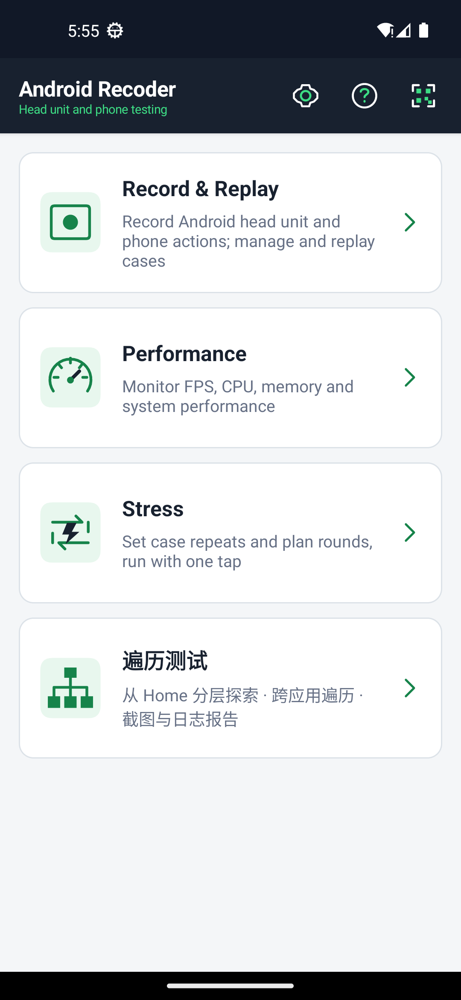
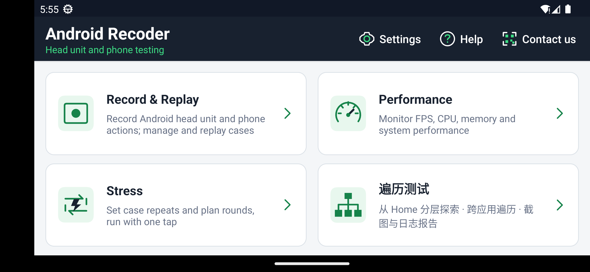
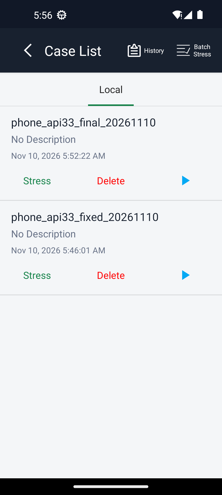
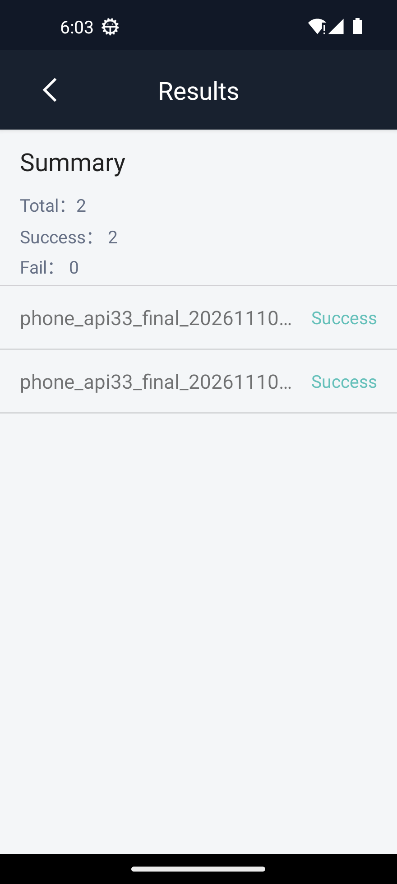
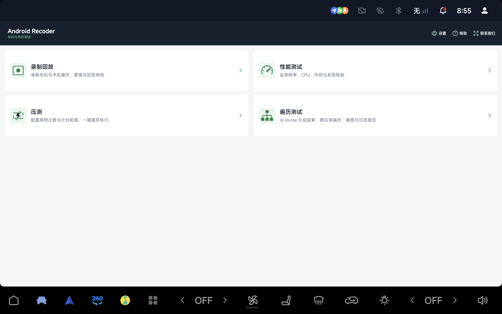
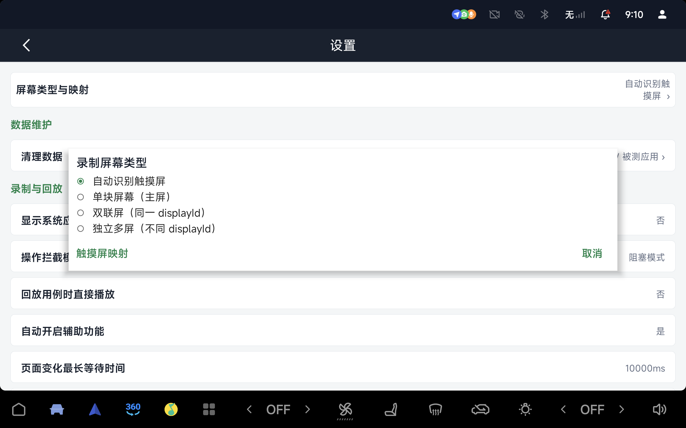
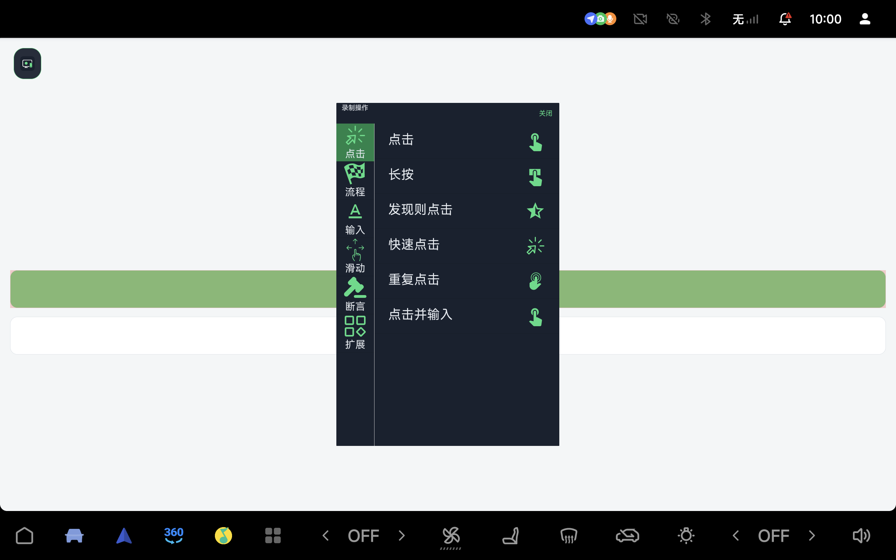

# Release Tools

本仓库集中提供工具安装说明和 Release 产物，首个工具为 Android Recoder。项目源码保持私有。

[下载 APK](https://github.com/xuegang-cn/release-tools/releases/download/android-recoder-v1.0.2-2611101401/android-recoder.apk) · [下载 SHA-256 校验文件](https://github.com/xuegang-cn/release-tools/releases/download/android-recoder-v1.0.2-2611101401/android-recoder.apk.sha256) · [自适应验证包发布页](https://github.com/xuegang-cn/release-tools/releases/tag/android-recoder-v1.0.2-2611101401) · [English](README_eng.md)

## 工具目录

| 工具 | 用途 | 安装包 |
|---|---|---|
| [Android Recoder](#android-recoder) | Android 车机与手机操作录制回放、性能采集、循环与批量压测 | [1.0.2-2611101401 APK](https://github.com/xuegang-cn/release-tools/releases/download/android-recoder-v1.0.2-2611101401/android-recoder.apk) |

## Android Recoder

Android Recoder 是可原生安装在 Android 车机和手机上的测试工具，主应用包名为 `com.android.recoder`。可把屏幕操作保存为用例，回放检查执行结果，再按设定次数循环运行；性能采集用于观察被测应用运行时的指标。

### 主要功能

| 功能 | 说明 |
|---|---|
| 录制与回放 | 普通模式选择控件后，再选择点击、输入、滑动或断言等动作；简易模式直接记录点击和滑动。可跨应用录制系统操作，并从用例列表回放。 |
| 性能采集 | 选择被测应用与可用指标，采集帧率、CPU、内存等数据，保存记录并查看曲线。具体指标受系统接口与权限影响。 |
| 循环与批量压测 | 单个用例可重复执行；批量计划可设置各用例次数、执行顺序和整组循环轮数。每次执行保留结果，失败后继续，也可从浮窗停止。 |
| 屏幕类型与映射 | 提供自动识别、单屏、同一 display 的双联屏和独立多屏选项，以及触摸源映射；支持鼠标与 ADB 注入输入捕获，浮窗避让系统栏。 |
| 通用界面 | 根据当前窗口实际可用宽度调整，窄屏单列、达到 600dp 后双列，旋转时重新排版；窄屏用例名称与操作按钮分行显示，默认配置不绑定汽车厂商。 |

### 适用条件

同一 APK 包含 ARMv7、ARM64 和 x86_64 原生库，安装时由 Android 选择匹配版本。最低 Android API 为 18；手势需 Android 7 及以上，无障碍截图与独立多屏录制回放需 Android 11 及以上。设备需允许所用功能的 ADB、无障碍、悬浮窗、存储或录屏授权，完整步骤见下文。

旧截图动作和主屏 Capture 模式不支持副屏，副屏节点与手势取决于设备开放的接口。

## 版本与实测范围

本次发布标签为 `android-recoder-v1.0.2-2611101401`，提供**手机与车机自适应验证包（Debug 签名）**，`versionName=1.0.2-2611101401`、`versionCode=41`，可直接安装，无需源码或编译，尚未采用正式生产签名。它与此前车机验证包的签名相同，可用 `adb install -r -g` 覆盖安装。

2026 年 11 月 10 日，在 Android 11 / API 30 和 Android 13 / API 33 手机模拟器上验证自适应改动。各次验证范围如下，避免将前一包的完整录放结果当作最终包的全部实测结果：

| 验证包 | 结果 |
|---|---|
| `1.0.2-2611101348` | 两套模拟器均录制并保存一条 `CLICK`，计数 0→1；清零后回放为 `passed`，计数再次 0→1。Android 13 录制中完成竖→横→竖切换后仍可选择动作。Android 11 另采集 CPU、内存约 22.6 秒，生成 5 份有效 CSV。 |
| `1.0.2-2611101354` | 修复首页切列时序。两套模拟器竖→横→竖后均保留四个入口，Android 11 再次回放通过；Android 13 的 320dp 窄窗口验证列表和两轮循环回放，2 成功、0 失败。 |
| `1.0.2-2611101401`，本次附件 | 修复长用例名覆盖结果状态。Android 13 的 320dp 窄窗口再次完成两轮回放，2 成功、0 失败；Android 11 安装启动成功。 |

`app` 与 `common` 模块的自动测试共 218 项，217 项通过，1 项跳过。附件 SHA-256：`0686d02300dd452c054b1f92f79ed5cecb3cf40ee54742e8ac1dfbf96bf7999f`。

此前的 `1.0.2-2611021607` 曾于 2026 年 11 月 2 日在一台 API 33 车机主屏上完成一条 `CLICK` 的普通录制、保存和回放，计数均为 0→1。本次未重新连接实体车机或手机；其他品牌的后台策略、多屏硬件、功耗和长时间运行仍需实测。此前版本保留在[旧发布页](https://github.com/xuegang-cn/release-tools/releases/tag/android-recoder-v1.0.2)。

## 手机模拟器预览

以下截图来自自适应调试包，展示手机单列、横屏双列、320dp 用例列表及两轮回放结果。








## 实机预览

三张截图均来自 2026 年 11 月 2 日的 API 33 车机验证，原图为 2560×1600。







普通录制动作菜单展示在独立测试页面上，红框为选中控件高亮；该测试页面并非产品内置界面。

## 1. 下载、校验和安装

电脑安装 Android SDK Platform Tools，将 `adb` 加入 PATH。Windows 已设置 `ANDROID_HOME` 时，也可将下方 `$adb` 改为 `Join-Path $env:ANDROID_HOME 'platform-tools\adb.exe'`。下载 APK 和校验文件到同一目录，在该目录打开 PowerShell，对照两份输出的 SHA-256：

```powershell
Get-FileHash .\android-recoder.apk -Algorithm SHA256
Get-Content .\android-recoder.apk.sha256
```

在车机上开启开发者选项和 USB 调试，连接电脑并在设备上接受调试授权，再执行：

```powershell
$adb = 'adb'
$deviceArgs = @()
# 连接多个设备时，填写 adb devices 输出的目标序列号：
# $deviceArgs = @('-s', '设备序列号')
& $adb devices -l
& $adb @deviceArgs install -r -g .\android-recoder.apk
& $adb @deviceArgs shell am start -n com.android.recoder/com.android.recoder.activity.SplashActivity
```

设备状态应为 `device`；`unauthorized` 时在设备上接受电脑授权，`offline` 时先恢复连接。`-r` 保留数据覆盖安装，`-g` 仅授予系统允许的运行时权限，不能代替悬浮窗、无障碍或录屏同意。macOS / Linux 可在终端直接使用 `adb` 执行同样的安装与设备命令。

下文命令沿用 `$adb` 和 `$deviceArgs`，同时只针对选定设备操作。遇到安装签名冲突时，先核对已安装应用的包名和签名并导出需要的数据；不要用卸载代替问题排查。

## 2. 接入设备本机 ADB

应用需要本机 ADB 时，在设置中填写设备已启用且允许使用的 ADB 服务地址。电脑 USB 调试授权不等于应用本机连接已获授权，首次连接仍可能出现系统调试认证，需在车机上确认。

此前车机测试使用设备原有的 `5555` 监听。若设备没有本机 ADB 监听，需按 ROM 或设备维护方提供的方式开启；支持传统 TCP ADB 的设备，可在已获授权的 USB 会话中执行以下命令，再在应用设置中使用 `localhost:5555`：

```powershell
& $adb @deviceArgs tcpip 5555
```

此命令会重启设备的调试服务并开启网络监听，设备需先允许调试连接；应用首次连接时仍可能要求设备端确认。只在可信网络中使用，需要关闭传统 TCP 监听时可在连接仍可用的情况下执行 `adb @deviceArgs usb`。Android 11 及以上系统中的“无线调试”可能使用独立的配对码和动态端口，不等同于固定的 `5555` 服务。

API 30 模拟器验证使用了专用端口桥接；该测试配置不能证明实体设备可免授权接入。安装 APK 不会自动取得 ADB、无障碍或系统录屏授权。

## 3. 悬浮窗、后台与存储权限

在系统设置允许 Android Recoder 显示在其他应用上层，并允许忽略电池优化。没有对应设置入口时，可在已连接的 ADB 会话中执行：

```powershell
$deviceUserId = (& $adb @deviceArgs shell am get-current-user).Trim()
if ($LASTEXITCODE -ne 0 -or $deviceUserId -notmatch '^\d+$') { throw '无法读取当前用户' }
& $adb @deviceArgs shell appops set --user $deviceUserId com.android.recoder SYSTEM_ALERT_WINDOW allow
& $adb @deviceArgs shell dumpsys deviceidle whitelist +com.android.recoder
& $adb @deviceArgs shell appops get --user $deviceUserId com.android.recoder SYSTEM_ALERT_WINDOW
& $adb @deviceArgs shell dumpsys deviceidle whitelist
```

悬浮窗结果应含 `SYSTEM_ALERT_WINDOW: allow`，省电白名单应含 `com.android.recoder`。白名单可免除部分 Android 省电限制，不能保证进程始终存活。车机 ROM 的自启动、后台运行及熄屏或下电清理设置仍需另行允许，没有适用于所有厂商的通用命令。

按应用引导允许所需存储权限。若权限被关闭，在应用信息页重新允许；也可先核对 APK 声明与授权状态：

```powershell
& $adb @deviceArgs shell dumpsys package com.android.recoder
```

存储行为随 Android 版本和应用 target SDK 变化。`-g` 不会授予系统签名权限；微信联系页无需相机权限。

## 4. 开启无障碍，保留其他服务

从应用权限引导或下方命令打开无障碍设置，找到 Android Recoder 并启用，按系统提示确认，保留其他应用已启用的服务。

```powershell
& $adb @deviceArgs shell am start -a android.settings.ACCESSIBILITY_SETTINGS
```

设备没有对应页面且 ROM 允许 shell 修改安全设置时，可追加本应用服务。以下 PowerShell 会先读取当前列表，读取失败即停止，不将其替换为空列表：

```powershell
$deviceUserId = (& $adb @deviceArgs shell am get-current-user).Trim()
if ($LASTEXITCODE -ne 0 -or $deviceUserId -notmatch '^\d+$') { throw '无法读取当前用户' }
$recoderService = 'com.android.recoder/com.android.recoder.shared.event.accessibility.AccessibilityServiceImpl'
$existingServices = (& $adb @deviceArgs shell settings --user $deviceUserId get secure enabled_accessibility_services).Trim()
if ($LASTEXITCODE -ne 0) { throw '无法读取无障碍服务列表，停止操作' }
$services = @($existingServices -split ':' | Where-Object { $_ -and $_ -ne 'null' })
if ($services -notcontains $recoderService) { $services += $recoderService }
$combinedServices = $services -join ':'
& $adb @deviceArgs shell settings --user $deviceUserId put secure enabled_accessibility_services $combinedServices
if ($LASTEXITCODE -ne 0) { throw '设备拒绝修改无障碍服务列表' }
& $adb @deviceArgs shell settings --user $deviceUserId put secure accessibility_enabled 1
& $adb @deviceArgs shell settings --user $deviceUserId get secure enabled_accessibility_services
& $adb @deviceArgs shell dumpsys accessibility
```

确认列表包含该组件，并在 `dumpsys accessibility` 中检查绑定状态。ROM 拒绝修改或要求额外确认时，通过系统设置或 ROM 维护方处理；`pm grant ... BIND_ACCESSIBILITY_SERVICE` 不能代替启用服务。

## 5. 典型录制与回放流程

1. 首页进入“录制回放”，创建录制。默认选择“跨应用 / 系统操作”，不绑定启动应用；需要指定应用时取消该选项。名称可留空自动生成，描述选填，简易录制默认关闭。
2. 点击“开始录制”准备，再点击悬浮工具条的绿色三角开始记录。普通模式下先选中目标控件，再从动作菜单选择点击、输入等操作，执行后记录该步骤。
3. 完成后点击收起的 Android Recoder 图标，选择“流程”→“结束”保存。工具条关闭按钮不能代替结束保存。
4. 在最近用例或全部用例中选择“回放”。设置中的“回放用例时直接播放”默认是“否”，进入回放后需点击悬浮工具条开始；改为“是”才自动开始。执行中可从回放悬浮窗停止，完成后查看结果。

循环与批量压测从各自的“开始执行”或“开始批量压测”按钮直接运行，不需要再点击普通回放工具条开始。

需要截图或屏幕捕获时，按系统对话框确认录屏授权。安装参数 `-g`、悬浮窗和电池白名单均不能替代系统录屏同意。Android 版本、系统接口和权限会影响可获取的节点、日志与截图。

## 6. 输入文字与键盘恢复

手工输入时使用车机自带、可正常打字的系统键盘。录制输入操作时，在动作菜单选择“输入”，使用工具输入框填写并确认。ADB Keyboard 与 Android Recoder 自动化输入法用于注入文字，不作为日常键盘。

录制或回放可能临时切换自动化输入法，结束后检查系统键盘恢复。异常时先结束并保存录制，再查询实际用户和输入法：

```powershell
& $adb @deviceArgs shell am get-current-user
& $adb @deviceArgs shell ime list -s
& $adb @deviceArgs shell settings get secure default_input_method
```

从列表选择设备自带的正常键盘，按实际用户 ID 和组件执行以下命令；不同厂商的组件名不同：

```powershell
# 将 USER_ID 和 PACKAGE/IME_CLASS 替换为设备查询结果：
& $adb @deviceArgs shell ime set --user USER_ID PACKAGE/IME_CLASS
```

## 7. 旧包并存与控制端口冲突

主应用包名为 `com.android.recoder`。旧包名应用会独立保留，数据、用例和授权不自动迁移；需要的内容请先导出，再在新版导入并重新授权。覆盖更新要求包名与签名均一致。

控制服务默认端口为 `23342`。并行安装的其他应用占用该端口时，可将本应用的 `KEY_CONTROL_PORT` 改为可用的 `5000`～`65535` 端口。以下以 `23344` 为例，URI 中的 `&` 由远端单引号与 PowerShell 外层双引号保护：

```powershell
& $adb @deviceArgs shell "am start -W -n com.android.recoder/com.android.recoder.common.scheme.AdbSchemeActivity -d 'android-recoder://startaction/config?action=set&key=KEY_CONTROL_PORT&value=23344'"
& $adb @deviceArgs shell "am start -W -n com.android.recoder/com.android.recoder.common.scheme.AdbSchemeActivity -d 'android-recoder://startaction/config?action=get&key=KEY_CONTROL_PORT'"
```

端口更改会中断现有控制会话，相关客户端或端口转发需按新端口重连；新端口启动失败时保留原端口。这里修改的是应用控制端口，不会开启设备 ADB 网络监听。

## 联系作者

应用首页“联系我们”及帮助中的“联系作者”可打开完整微信联系卡，无需相机权限。
