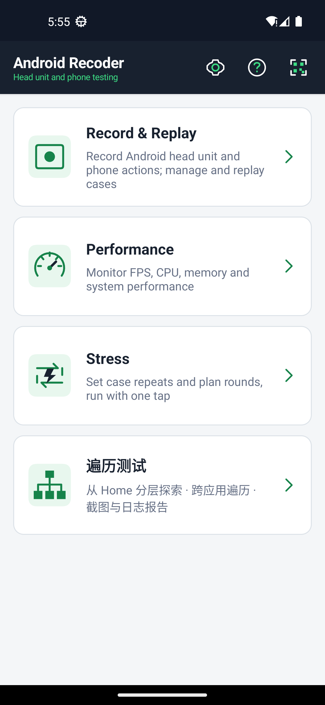
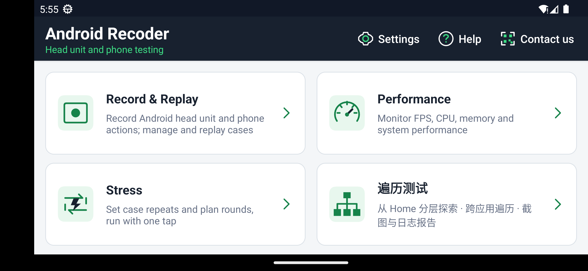
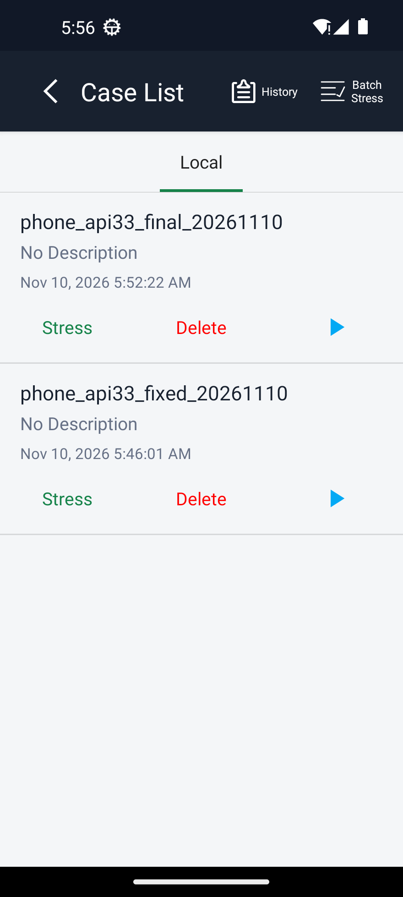
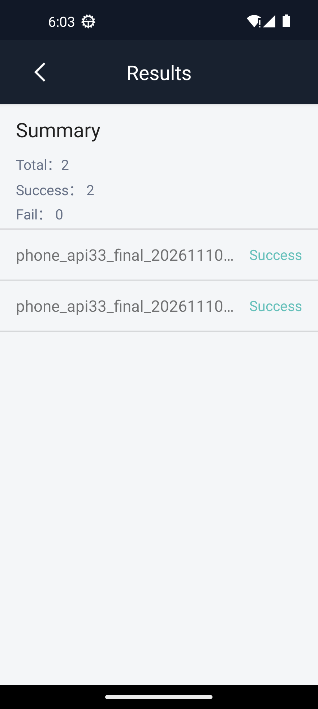
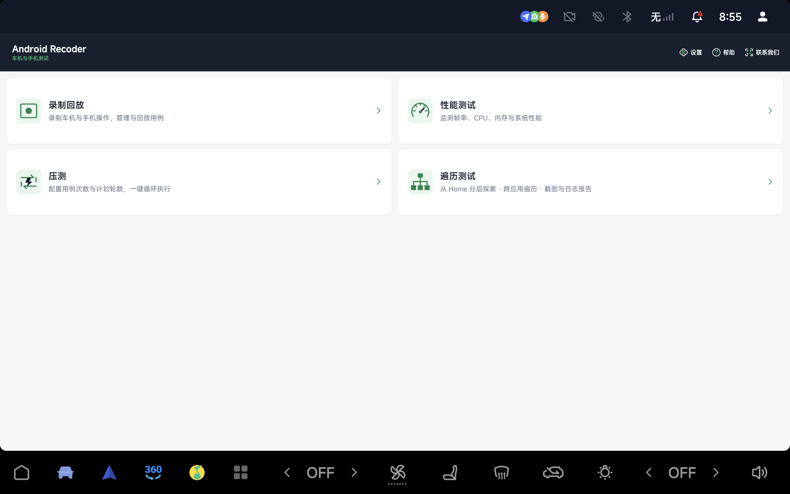
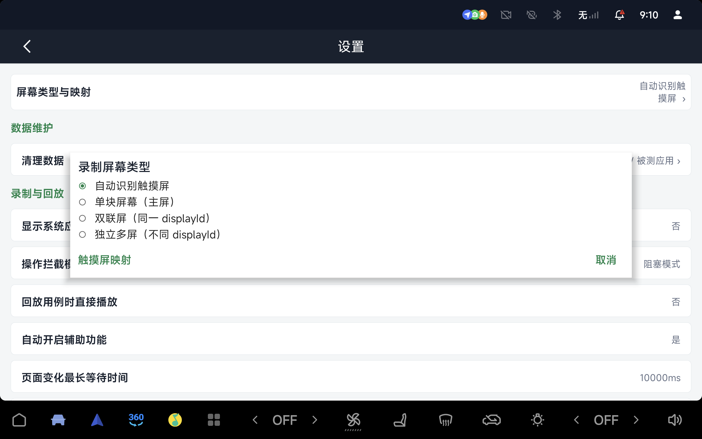
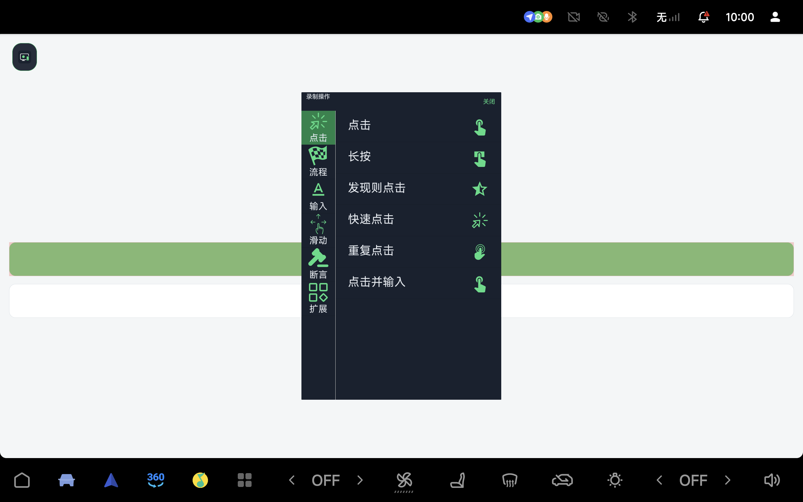

# Release Tools

This repository collects tool installation instructions and release artifacts. Android Recoder is its first tool; project source remains private.

[Download APK](https://github.com/xuegang-cn/release-tools/releases/download/android-recoder-v1.0.2-2611101401/android-recoder.apk) · [SHA-256 checksum](https://github.com/xuegang-cn/release-tools/releases/download/android-recoder-v1.0.2-2611101401/android-recoder.apk.sha256) · [Android Recoder 1.0.2-2611101401 release](https://github.com/xuegang-cn/release-tools/releases/tag/android-recoder-v1.0.2-2611101401) · [中文](README.md)

## Tool directory

| Tool | Purpose | Download |
|---|---|---|
| [Android Recoder](#android-recoder) | Android recording/replay, performance collection and repeated/batch case testing, with adaptive phone and head-unit layouts | [1.0.2-2611101401 APK](https://github.com/xuegang-cn/release-tools/releases/download/android-recoder-v1.0.2-2611101401/android-recoder.apk) |

## Android Recoder

Android Recoder is a native Android testing app for head units and phones, with application ID `com.android.recoder`. Save screen interactions as cases, replay them to inspect results, and repeat them for a configured run count. Performance collection records metrics while the selected app runs. Project source remains private; this repository distributes the APK and setup instructions.

### Main features

| Feature | Behavior |
|---|---|
| Recording and replay | Normal mode selects a control, then an action such as click, input, swipe or assertion. Easy mode records taps and swipes directly. Record across apps and system controls, then replay from the case list. |
| Performance collection | Choose an app and available metrics, collect frame rate, CPU and memory data, save records and view curves. Metrics depend on system interfaces and permissions. |
| Repeated and batch testing | Repeat one case or configure per-case counts, case order and whole-plan rounds. Each execution keeps a result; failures continue, and floating controls can stop a run. |
| Screen modes and mapping | Choose automatic detection, single screen, joined panels on one display, or independent displays, and configure touch-source mapping. Input capture supports mouse and ADB injection; floating controls avoid system bars. |
| Vendor-neutral adaptive UI | Layout follows the available safe window width: Home uses one column below 600 dp and two columns at 600 dp or wider. Case and result rows adapt to narrow screens, with long names truncated. Rotation refreshes the layout, and floating controls stay within the usable screen area. Device/recording icons and gray-green colors do not assume a particular manufacturer. |

### Requirements

The APK includes ARMv7, ARM64 and x86_64 libraries, with minimum Android 4.3 / API 18. Gestures require Android 7 / API 24 or later; accessibility screenshots and independent-display recording/replay require Android 11 / API 30 or later. The device must permit the ADB, accessibility, overlay, storage or screen-capture access required by the feature; setup steps follow below. A supported Android version or CPU architecture alone does not guarantee that a vendor's ROM exposes every required interface.

Legacy screenshot actions and primary-screen Capture mode reject secondary displays. Secondary-display nodes and gestures depend on exposed device interfaces.

## Version and validation scope

Release tag `android-recoder-v1.0.2-2611101401` provides a **Debug-signed integration test APK**, version name `1.0.2-2611101401`, version code `41`, approximately 8.44 MB. It installs without source or compilation and does not use a production signing identity. Installation does not enable or bypass device authorization and permissions.

Expected APK SHA-256:

```text
0686d02300dd452c054b1f92f79ed5cecb3cf40ee54742e8ac1dfbf96bf7999f
```

Validation is scoped to the exact builds and environments below:

| Build | Environment | Observed result |
|---|---|---|
| `1.0.2-2611101401` (this APK) | Android 13 / API 33 emulator, 320 dp window width | A repeated case ran twice: two passed, zero failed, and the test page counter reached 2. The result row's long case name was checked after the ellipsis fix. |
| `1.0.2-2611101401` (this APK) | Android 11 / API 30 emulator | Installation and launch checked. Recording/replay was not rerun on this final APK. |
| Earlier `1.0.2-2611101348` build | Android 11 / API 30 and Android 13 / API 33 emulators | Ordinary recording saved exactly one `CLICK`. After resetting the test page counter to 0, replay passed and reached 1 on both emulators. On API 30, CPU/memory collection ran for 22.599 seconds and produced five CSV files. |
| Earlier `1.0.2-2611101354` build | Android 11 / API 30 and Android 13 / API 33 emulators | Home retained all four cards through portrait → landscape → portrait on both emulators. Ordinary replay also passed on API 30. |
| Older `1.0.2-2611021607` APK, November 2, 2026 | One Android 13 / API 33 head unit, primary display | Normal recording saved one `CLICK`; after resetting the counter, replay passed and changed it from 0 to 1. This hardware result belongs to the older APK. |

The current `app` and `common` automated test run contains 218 tests: 217 passed and one was skipped. There has been no fresh physical-device validation of this release. Emulator checks and the earlier single-head-unit test do not establish compatibility across phone brands, head-unit manufacturers or ROMs. Permissions, background policies and multi-display behavior require validation on the target device.

## Device previews

### Phone and narrow-window previews

These emulator previews show the adaptive layout; they are not physical-phone validation.









### Earlier head-unit previews

The following three images were captured on the older `1.0.2-2611021607` APK on one API 33 head unit's primary display at 2560×1600. They illustrate its recording and screen-setting workflow, not hardware validation of the current APK.







The normal action menu appears over a separate test page, with the selected control outlined in red. The test page is not a built-in product screen.

## 1. Download, verify and install

Install Android SDK Platform Tools on your computer and put `adb` on PATH. On Windows with `ANDROID_HOME` configured, you can instead set `$adb = Join-Path $env:ANDROID_HOME 'platform-tools\adb.exe'`. Save the APK and checksum together, open PowerShell in that folder, and compare the SHA-256 values:

```powershell
Get-FileHash .\android-recoder.apk -Algorithm SHA256
Get-Content .\android-recoder.apk.sha256
```

Enable developer options and USB debugging on the head unit, connect the computer, accept its authorization on the device, and run:

```powershell
$adb = 'adb'
$deviceArgs = @()
# Select the serial from adb devices when multiple devices are connected:
# $deviceArgs = @('-s', 'DEVICE_SERIAL')
& $adb devices -l
& $adb @deviceArgs install -r -g .\android-recoder.apk
& $adb @deviceArgs shell am start -n com.android.recoder/com.android.recoder.activity.SplashActivity
```

The device status must be `device`. For `unauthorized`, accept computer authorization on the device; resolve the connection before continuing if it is `offline`. `-r` updates while preserving data. `-g` grants eligible runtime permissions only, not overlay access, accessibility enablement or screen-capture consent. On macOS/Linux, use `adb` directly in a terminal for the same device and installation commands.

The following PowerShell blocks reuse `$adb` and `$deviceArgs` for the selected device. If installation reports a signing conflict, check the installed package and signing identity and export needed data before making changes; do not use uninstalling as a troubleshooting shortcut.

## 2. Connect to existing on-device ADB

When the app needs on-device ADB, enter an endpoint already enabled and permitted by that device in Settings. Computer USB authorization does not authorize the app's own connection. Its first connection may produce another system debugging prompt that must be accepted on the head unit.

The earlier head-unit test device already listened on port 5555; installation did not enable a new network listener. Obtain the supported connection method from the ROM or device maintainer. Do not assume that on-device ADB is open or needs no authorization, or that `adb tcpip 5555` is required.

If the device supports the legacy USB-to-TCP method, first connect and authorize a computer over USB, verify that `adb devices -l` reports `device`, then explicitly enable the listener:

```powershell
& $adb @deviceArgs tcpip 5555
```

This command restarts the device's debugging service and enables its network listener. For the app's connection on that same device, `localhost:5555` is a possible endpoint only when the ROM permits loopback ADB. Accept the app's own debugging authorization prompt when shown. For a computer connection over a trusted local network, use `adb connect DEVICE_IP:5555` with the device's actual address, then select that endpoint's serial for subsequent commands. The listener may need to be enabled again after a reboot. Run `& $adb @deviceArgs usb` while the selected connection is available when you want to return to USB mode.

Android 11 and later Wireless debugging uses the pairing and connection addresses shown by the system, which may have different dynamic ports; do not substitute port 5555 automatically. The app also needs to support that device's connection/authentication method. The API 30 emulator validation used a dedicated port bridge; this test setup does not establish authorization-free access on physical devices. If the ROM disallows the connection or authorization, installation commands cannot override it.

## 3. Overlay, background and storage permissions

In system settings, allow Android Recoder to display over other apps and exempt it from battery optimization. If those settings are unavailable, use the connected ADB session:

```powershell
$deviceUserId = (& $adb @deviceArgs shell am get-current-user).Trim()
if ($LASTEXITCODE -ne 0 -or $deviceUserId -notmatch '^\d+$') { throw 'Cannot read active user' }
& $adb @deviceArgs shell appops set --user $deviceUserId com.android.recoder SYSTEM_ALERT_WINDOW allow
& $adb @deviceArgs shell dumpsys deviceidle whitelist +com.android.recoder
& $adb @deviceArgs shell appops get --user $deviceUserId com.android.recoder SYSTEM_ALERT_WINDOW
& $adb @deviceArgs shell dumpsys deviceidle whitelist
```

Confirm `SYSTEM_ALERT_WINDOW: allow` and a battery whitelist entry containing `com.android.recoder`. This exempts the app from some Android power restrictions, not all process termination. Separately allow OEM autostart, background running and screen-off or power-off retention where applicable; there is no universal command for every vendor's policies.

Allow required storage permissions through the app's guidance. If disabled later, restore them in App Info. Inspect the APK's declared and granted permissions with:

```powershell
& $adb @deviceArgs shell dumpsys package com.android.recoder
```

Storage behavior varies by Android version and target SDK. `-g` cannot grant system-signature permissions. The WeChat contact screen does not need camera permission.

## 4. Enable accessibility while retaining other services

Open accessibility settings from the app's permission guide or the command below, enable Android Recoder, and accept the system prompt. Leave other enabled services unchanged.

```powershell
& $adb @deviceArgs shell am start -a android.settings.ACCESSIBILITY_SETTINGS
```

If the device has no settings page and its ROM permits shell changes to secure settings, append this service with the following PowerShell. It reads the existing list first and stops on read failure rather than replacing the list with an empty value:

```powershell
$deviceUserId = (& $adb @deviceArgs shell am get-current-user).Trim()
if ($LASTEXITCODE -ne 0 -or $deviceUserId -notmatch '^\d+$') { throw 'Cannot read active user' }
$recoderService = 'com.android.recoder/com.android.recoder.shared.event.accessibility.AccessibilityServiceImpl'
$existingServices = (& $adb @deviceArgs shell settings --user $deviceUserId get secure enabled_accessibility_services).Trim()
if ($LASTEXITCODE -ne 0) { throw 'Cannot read enabled services; stopping' }
$services = @($existingServices -split ':' | Where-Object { $_ -and $_ -ne 'null' })
if ($services -notcontains $recoderService) { $services += $recoderService }
$combinedServices = $services -join ':'
& $adb @deviceArgs shell settings --user $deviceUserId put secure enabled_accessibility_services $combinedServices
if ($LASTEXITCODE -ne 0) { throw 'Device rejected the service-list update' }
& $adb @deviceArgs shell settings --user $deviceUserId put secure accessibility_enabled 1
& $adb @deviceArgs shell settings --user $deviceUserId get secure enabled_accessibility_services
& $adb @deviceArgs shell dumpsys accessibility
```

Confirm the component appears in the list and check binding in `dumpsys accessibility`. If the ROM rejects the change or requires extra confirmation, use system settings or contact the ROM maintainer. `pm grant ... BIND_ACCESSIBILITY_SERVICE` does not enable the service.

## 5. Typical recording and replay workflow

1. Open Recording/Replay from Home and create a recording. Cross-app / System UI mode is selected by default and does not bind a startup app; uncheck it to choose an app. A blank name is generated automatically; description is optional. Easy mode is off by default.
2. Press Start recording to prepare, then press the floating toolbar's green triangle to start capturing. In normal mode, select a target control, choose an action such as Click or Input from its menu, and execute it to record the step.
3. Open the collapsed Android Recoder icon and select Flow → Finish to save. Closing the toolbar does not save the case.
4. Select Replay from recent or all cases. The setting labeled “回放用例时直接播放” (start replay immediately) defaults to No, so press the floating replay toolbar's Start control. Setting it to Yes starts automatically. Stop from the floating control when needed and inspect the result afterward.

Repeated and batch tests start directly from their own Start execution or Start batch test buttons; they do not require the ordinary replay toolbar's Start action.

Accept system screen-capture prompts when required. Installation `-g`, overlay access and battery exemption do not replace screen-capture consent. Available nodes, logs and screenshots depend on Android version, system interfaces and permissions.

## 6. Text input and keyboard recovery

Use a normal system keyboard for manual typing. To record input, choose Input from the action menu and fill in the tool's input field. ADB Keyboard and the Android Recoder automation keyboard inject text and are not intended as everyday keyboards.

Recording or replay may temporarily switch keyboards. Check that the system keyboard returns afterward. If it does not, finish and save recording before inspecting the current user and installed keyboards:

```powershell
& $adb @deviceArgs shell am get-current-user
& $adb @deviceArgs shell ime list -s
& $adb @deviceArgs shell settings get secure default_input_method
```

Choose a normal device keyboard and substitute its actual user ID and component below. Keyboard component names differ by vendor:

```powershell
# Replace USER_ID and PACKAGE/IME_CLASS with the device's values:
& $adb @deviceArgs shell ime set --user USER_ID PACKAGE/IME_CLASS
```

## 7. Older installations and control-port conflicts

An older application with a different package remains separately installed. Cases, settings and grants do not migrate automatically; export needed data, import it into Android Recoder and authorize again. In-place updates require both the same package and signing identity.

The app control service defaults to port `23342`. If another installation occupies it, change `KEY_CONTROL_PORT` to an available port from `5000` to `65535`. This example uses `23344`; remote single quotes and outer PowerShell double quotes protect the URI's `&` characters:

```powershell
& $adb @deviceArgs shell "am start -W -n com.android.recoder/com.android.recoder.common.scheme.AdbSchemeActivity -d 'android-recoder://startaction/config?action=set&key=KEY_CONTROL_PORT&value=23344'"
& $adb @deviceArgs shell "am start -W -n com.android.recoder/com.android.recoder.common.scheme.AdbSchemeActivity -d 'android-recoder://startaction/config?action=get&key=KEY_CONTROL_PORT'"
```

A successful change interrupts the current control session; reconnect clients or forwards using the new port. If binding fails, the previous port is retained. This changes the app's control port and does not enable a device ADB network listener.

## Contact

Home's Contact Us entry and Help's Contact Author entry display the complete WeChat contact card inside the APK without camera permission.
